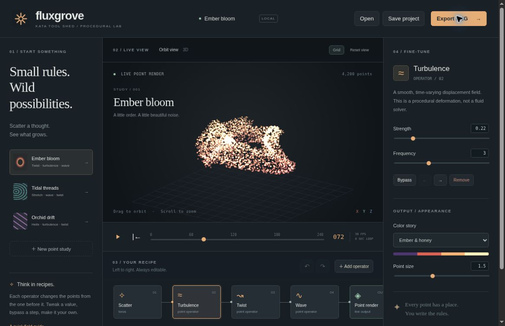
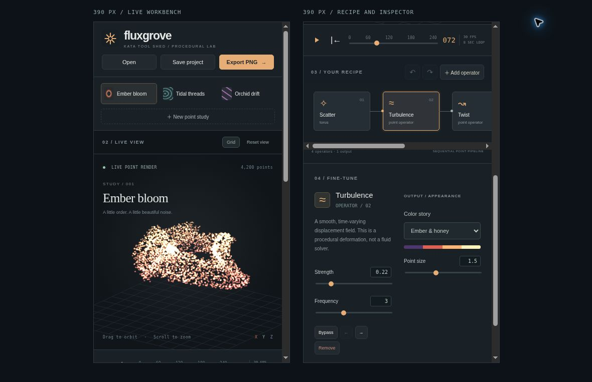

# Kata Fluxgrove

**Small rules. Wild possibilities.** A local-first procedural point-art workbench inspired by Houdini's editable node workflows, with an original botanical-industrial identity.

Part of [Kata Tool Shed](https://intrepion.github.io/tools/). Repository: `kata-app-inspired-by-houdini-codex-dot`.

## Screenshots

These are captures of the actual running localhost app, not mockups.



<details><summary>Narrow-screen workbench and inspector, 390px frames</summary>



</details>

## Run locally

Node.js 18 or newer. No package dependencies or install step.

```sh
npm run dev
```

Visit the server's printed address, normally **http://127.0.0.1:4177**. Always use an HTTP server; do not open the files directly. Override the port with `PORT=4300 npm run dev` (PowerShell: `$env:PORT=4300; npm run dev`).

```sh
npm run check  # Syntax checks and 20 Node tests
npm run build  # Static deployable files in dist/
```

Serve `dist/` with any static HTTP server. The development server also serves `tests/browser.html`, a browser-native UI and Canvas test suite, and `tests/responsive.html`, two 390px iframes showing the top and lower portions of the narrow layout. Test pages are excluded from production output. The browser suite changes this origin's autosaved study, so download any project you want to keep before running it.

## Make a study

1. Start with **Ember bloom**, **Tidal threads**, **Orchid drift**, or a new point study.
2. Select **Scatter** to choose a torus, sphere surface, helix, or square grid. Set the seed, radius, and point count. The seed affects randomized sources; the regular grid does not change with the seed.
3. Add **Turbulence**, **Twist**, **Wave**, **Gather**, or **Stretch**. Select any operator to edit its parameters. Use Bypass, the left/right arrows, or Remove to change the recipe. Scatter stays first. Up to 12 operators, including Scatter, are supported.
4. Play or scrub the 0–240 frame timeline. Drag the view to orbit and scroll to zoom. Use **Reset view** to return to the starting camera.
5. Choose a color story and point size. **Save project** downloads editable `.fluxgrove` JSON. **Open** restores a validated project. **Export PNG** downloads a clean 1600 × 1000 point rendering of the current frame and camera, including the ground grid if enabled.

Edits have 30-step Undo/Redo. Camera changes, timeline navigation, and grid visibility are view operations rather than undoable edits. Save project captures the current camera and frame; grid visibility is a transient view setting. Presets, new studies, and opened projects remain undoable. Replacing unsaved work prompts before proceeding.

## Keyboard and accessibility

- **Space:** play/pause outside form controls and buttons.
- **Ctrl/⌘ Z:** undo; **Ctrl/⌘ Shift Z:** redo.
- **Ctrl/⌘ S:** download a project.
- Focus the canvas, then use **arrow keys** to orbit, **+ / −** to zoom, and **Home** to reset the camera.
- Controls use labels, visible focus states, selected/pressed states, semantic buttons, accessible dialogs, and a live status region. The point-art canvas is inherently visual and is not a full nonvisual modeling interface.
- On phone-width screens, presets move above the workbench and the inspector sits below it. The node chain scrolls horizontally; each operator remains reachable.

## What is real, and what is intentionally small

This is an original functional **procedural point-art kata**, not a Houdini replacement or compatible editor. It generates 500–7,000 deterministic points, applies an ordered linear chain of deformations, projects them into a camera view, and draws them with Canvas 2D. It uses no remote assets, rendering service, or backend.

It is **not** a physics simulation. There are no fluid, smoke, rigid-body, cloth, collision, or particle-advection solvers. Turbulence is an analytic displacement field. The network is sequential, not a free-wired branching graph. The camera uses orthographic projection with depth ordering and point-size shading, not a perspective lens or surface renderer. There is no mesh export, timeline keyframing, expression language, Houdini `.hip` support, USD, VDB, Alembic, video export, or Houdini Engine integration.

The timeline targets 30 frame updates per second on capable hardware. Actual playback speed depends on browser and CPU. The loop restarts at zero and is not guaranteed seamless. Export is a still image. The fixed PNG aspect ratio can show a different crop from the on-screen viewport.

## Storage and privacy

Project data stays in your browser. There is no account, analytics, network asset request, or upload. Autosave is best-effort local storage for one study on this origin. Storage cleanup, private browsing, origin changes, and browser limits can remove or prevent it. Download project files for durable backups. Undo history is memory-only and does not survive reload.

Imports are limited to 500 KB, checked for format/version and node types/order, and normalized to bounded numeric settings. Duplicate and unsafe node IDs are replaced. Project titles are rendered as text. Browser autosave failures are reported without blocking the editor.

## Files

- `src/model.js`: source shapes, deterministic randomness, operators, import validation, and history.
- `src/renderer.js`: 3D projection, color interpolation, and Canvas renderer.
- `src/app.js`: workbench UI, editing, playback, files, autosave, and keyboard input.
- `docs/INSPIRATION.md`: primary-source research and scope decisions.
- `docs/QA.md`: verification and limitations.
- `app.json`: Tool Shed catalog metadata and backlink.

## License and attribution

MIT, see [LICENSE](LICENSE). All app code, icons, preset artwork, and procedural studies are original. Inspired by [SideFX Houdini](https://www.sidefx.com/products/houdini/), with no affiliation or endorsement and no borrowed product assets or compatible file formats.

The combined `.gitignore` covers Windows, macOS, Linux/Unix, editors, dependencies, builds, local secrets, and test artifacts. This prototype has not been pushed, published, or deployed.
